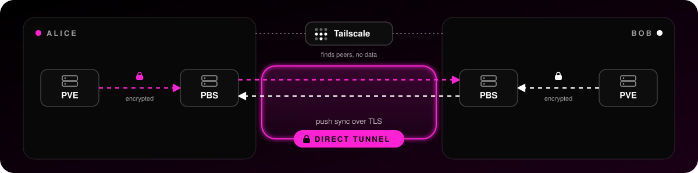

<h1 align="center">Share Proxmox Backup Server</h1>



> _Store your encrypted backups with a friend. Your friend stores their encrypted backups with you._

Swap encrypted Proxmox Backup Server (PBS) backups with friends. Each person offers S3 storage to the other. Nobody gets access to the PBS server of the other.

Each person runs two LXC containers: a PBS server and an rclone server. The rclone server shows a folder as S3 storage, and the PBS server of your friend writes its backups there. Tailscale connects the nodes. The backup data goes directly between them in an encrypted tunnel.

In your PBS, make one S3 datastore for each friend that stores your backups. Two friends give you two offsite copies.

## ✔ Requirements before start

Make sure you have the following (proxmox and rclone LXC containers) installed and a Tailscale account:

- [Proxmox Backup Server](https://community-scripts.org/scripts/proxmox-backup-server) 4.2 or later.
- [rclone](https://community-scripts.org/scripts/rclone), the version must have the command `rclone serve s3`.
- [Tailscale](https://tailscale.com/download/linux) account

> This guide only helps you to configure PBS and rclone assuming that are LXC. It does not install them, you need to do it before hand ⤴.

> Tailscale must be installed on both LXC containers before you start.

## 1. Start on your Proxmox host (assuming PBS / rclone are LXC)

As a container shares the kernel of the host. Only the host can give it `/dev/net/tun`.

_Make sure the host has the device_

```
ls -l /dev/net/tun || modprobe tun
```

_Add the device to **both** LXC containers, PBS and rclone, and reboot them. Set `PBS_CTID` and `RCLONE_CTID` to the container IDs_

```bash
PBS_CTID=123 RCLONE_CTID=123
```

```bash
for id in $PBS_CTID $RCLONE_CTID; do \
  grep -q net/tun /etc/pve/lxc/$id.conf || printf "%s\n" \
    "lxc.cgroup2.devices.allow: c 10:200 rwm" \
    "lxc.mount.entry: /dev/net/tun dev/net/tun none bind,create=file" \
    >> /etc/pve/lxc/$id.conf; \
  pct reboot $id; \
done
```

## 2. Mount the backup storage on the rclone LXC

rclone saves the backups in a folder. If the folder is not a mount point, the backups go to the system disk of the LXC. When this disk is full, the LXC stops.

A mount point gives the folder its own storage. Set the container ID, the Proxmox storage, and the size in GiB:

```bash
RCLONE_CTID=123 STORAGE=local-lvm SIZE=500
```

Add the mount point and reboot the rclone LXC:

```bash
pct set $RCLONE_CTID -mp0 $STORAGE:$SIZE,mp=/srv/backups-s3 && pct reboot $RCLONE_CTID
```

The size is also the limit for the backups. To use the web interface, select the LXC, then **Resources**, **Add**, **Mount Point**.

## 3. Then, on PBS:

```bash
bash -c "$(curl -fsSL https://raw.githubusercontent.com/frangeris/share-pbs/main/setup-pbs.sh)"
```

## 4. Finally on rclone:

```bash
bash -c "$(curl -fsSL https://raw.githubusercontent.com/frangeris/share-pbs/main/setup-rclone.sh)"
```

> Set a quota on the folder for your friend. Without a quota, your friend can fill your storage.

<details>
<summary><h2>Prefer doing a manual install? ↓</h2></summary>

Same steps as the script, by hand.

### 1. PBS LXC

In the PBS LXC, as `root`:

```bash
# Skip this line if the file does not exist. Without a subscription this repository returns 401.
mv /etc/apt/sources.list.d/pbs-enterprise.sources /etc/apt/sources.list.d/pbs-enterprise.sources.disabled

apt-get update
apt-get install -y curl
curl -fsSL https://tailscale.com/install.sh | sh
systemctl enable --now tailscaled
tailscale up
tailscale ip -4
```

Do not tag this node. Do not use `--accept-routes`.

### 2. rclone LXC

In the rclone LXC, as `root`. The commands use the folder `/srv/backups-s3`, the bucket `pbs`, and the port `8443`. To use other values, replace them in all commands.

1. Check that the folder is a mount point. If it is not, rclone writes to the disk of the LXC.

   ```bash
   mountpoint /srv/backups-s3
   ```

2. Install the packages and join Tailscale:

   ```bash
   apt-get update
   apt-get install -y curl jq openssl nftables
   curl -fsSL https://tailscale.com/install.sh | sh
   systemctl enable --now tailscaled
   tailscale up
   ```

3. Make the folders and read the Tailscale name of the node:

   ```bash
   mkdir -p /srv/backups-s3/pbs /etc/rclone-s3
   fqdn=$(tailscale status --json | jq -r '.Self.DNSName | rtrimstr(".")')
   ```

4. Make the settings file with random keys:

   ```bash
   install -m 600 /dev/null /etc/rclone-s3/env
   cat > /etc/rclone-s3/env <<EOF
   DATA_DIR=/srv/backups-s3
   PORT=8443
   ACCESS_KEY=$(openssl rand -hex 12)
   SECRET_KEY=$(openssl rand -hex 24)
   EOF
   ```

5. Make a self-signed certificate for the Tailscale name:

   ```bash
   openssl req -x509 -newkey rsa:4096 -nodes -days 3650 \
     -keyout /etc/rclone-s3/key.pem -out /etc/rclone-s3/cert.pem -subj "/CN=rclone" \
     -addext "subjectAltName=DNS:$fqdn"
   chmod 600 /etc/rclone-s3/key.pem
   ```

6. Block new connections from this LXC to the LAN:

   ```bash
   cat > /etc/rclone-s3/lan-block.nft <<'EOF'
   table inet pbsshare
   delete table inet pbsshare
   table inet pbsshare {
     chain out {
       type filter hook output priority 0; policy accept;
       ct state established,related accept
       udp dport { 53, 67 } accept
       tcp dport 53 accept
       ip daddr { 10.0.0.0/8, 172.16.0.0/12, 192.168.0.0/16 } drop
       ip6 daddr fc00::/7 drop
     }
   }
   EOF
   ```

7. Make the systemd service. If rclone is in another folder, for example `/opt/rclone/rclone`, use that path instead of `/usr/bin/rclone`:

   ```bash
   cat > /etc/systemd/system/rclone-s3.service <<'EOF'
   [Unit]
   Description=rclone S3 server
   After=network-online.target tailscaled.service
   Wants=network-online.target

   [Service]
   EnvironmentFile=/etc/rclone-s3/env
   ExecStartPre=/usr/sbin/nft -f /etc/rclone-s3/lan-block.nft
   ExecStart=/usr/bin/rclone serve s3 ${DATA_DIR} --addr :${PORT} --cert /etc/rclone-s3/cert.pem --key /etc/rclone-s3/key.pem --auth-key ${ACCESS_KEY},${SECRET_KEY}
   Restart=on-failure

   [Install]
   WantedBy=multi-user.target
   EOF
   ```

8. Start the service. The last command must show `active`:

   ```bash
   systemctl daemon-reload
   systemctl enable --now rclone-s3
   systemctl is-active rclone-s3
   ```

9. Show the five values and give them to your friend privately: endpoint, bucket, access key, secret key, fingerprint:

   ```bash
   echo "Endpoint: $fqdn:8443"
   cat /etc/rclone-s3/env
   openssl x509 -in /etc/rclone-s3/cert.pem -noout -fingerprint -sha256
   ```

If you change the port, use it in the access rules in step 3.

### 3. Tailscale admin console

1. In **Machines**, disable key expiry on the PBS node and on the rclone node.

   CAUTION: DISABLE KEY EXPIRY ON BOTH NODES. IF A KEY EXPIRES, THE BACKUPS STOP.

2. In **Access controls**, open the JSON editor. Delete the allow-all grant `{"src": ["*"], "dst": ["*"], "ip": ["*"]}`. Add these entries:

   ```json
   "tagOwners": {
       "tag:shared": ["autogroup:admin"],
   },

   "grants": [
       {"src": ["YOUR_LOGIN"], "dst": ["*"], "ip": ["*"]},
       {"src": ["autogroup:shared"], "dst": ["tag:shared"], "ip": ["8443"]},
   ],

   "tests": [
       {"src": "YOUR_LOGIN", "accept": ["OTHER_NODE_IP:22"]},
       {"src": "tag:shared", "deny": ["OTHER_NODE_IP:22"]},
   ],
   ```

   Use your Tailscale login and the IP of one of your other nodes. If the allow-all grant stays, the tests fail.

3. In **Machines**, apply the tag `shared` to the rclone node only. The console shows `shared`. The policy uses `tag:shared`.
4. Share the rclone node with your friend. Accept the rclone node that your friend shares with you.

A shared node can receive connections. It cannot start connections. This is enough, because the PBS server of your friend starts the connection. Each person shares only the rclone node.

If you tag the PBS node by mistake, you cannot remove the tag in the console. Enter `tailscale up --force-reauth` in the PBS LXC and sign in with your own user.

Do not share the Tailscale node that you use for access to your rack. Sharing gives access to that node only, not to the subnet behind it.

### 4. Test the isolation

Use the IP of one of your other nodes.

```bash
# In the rclone LXC. The result must be 124 (timeout).
timeout 3 bash -c '</dev/tcp/OTHER_NODE_IP/22'; echo $?

# In the PBS LXC. The result must be 0.
timeout 3 bash -c '</dev/tcp/OTHER_NODE_IP/22'; echo $?
```

### 5. Use the storage of your friend

In the PBS web interface (`https://<ip>:8007`):

1. Add an S3 endpoint. Enter the full Tailscale name of the rclone node of your friend, port `8443`, the access key, the secret key, and the fingerprint. Use path-style addressing.
2. Add a datastore. Enter a name, select the S3 datastore type, select the endpoint, and enter the bucket `pbs`. For **Backing Path**, enter an empty folder for the local cache. The disk must have 64 to 128 GiB free.
3. Make a PBS user or API token for PVE. Give it the role `DatastoreBackup` on this datastore only.

In the PVE web interface:

1. Add the datastore as a PBS storage. Enter the IP of your PBS, the user or token, the name of the datastore, and the fingerprint of your PBS (on the PBS **Dashboard**, select **Show Fingerprint**).
2. Set an encryption key for the storage. PVE saves the key in `/etc/pve/priv/storage/<ID>.enc`. Copy it to a safe place.

CAUTION: SET THE ENCRYPTION KEY BEFORE THE FIRST BACKUP. WITHOUT A KEY, YOUR FRIEND CAN READ THE BACKUPS.

CAUTION: SAVE THE ENCRYPTION KEY IN A SAFE PLACE. IF YOU LOSE THE KEY, YOU CANNOT READ THE BACKUPS.

### 6. Make sure that it works

1. Start a backup job in PVE for a small VM or LXC.
2. Make sure that the snapshot is in the datastore.
3. Do a test restore to a new ID. Do not restore over the original.
4. Do a test restore each week.

</details>

## Access

- The PBS web interface is at `https://<ip>:8007`.
- For the first login, use the user `root` and the realm `Linux PAM standard authentication`. The password is the `root` password of the LXC. To set it, run `pct exec <CTID> passwd` on the host.
- PBS users are separate from PVE users. In **Configuration**, **Access Control**, make a user `admin@pbs` with the role `Admin` for daily use.
- Make a new access key and secret key for S3. Your friend stores the secret in their PBS. Do not use a Proxmox password.

## Recovery

If your PBS server is lost, make a new PBS server. Create the datastore again with `reuse-datastore` and the same datastore name. You need the bucket access and your encryption key.

## Limits

- A restore reads the data from the home of your friend. The upload speed of your friend limits the restore time.
- S3 storage does not encrypt data. Only the encryption key in PVE protects it.
- The host cannot force the client to encrypt.
- rclone has no permissions for each bucket. Run one rclone instance for each friend.
- Each PBS cache needs 64 to 128 GiB.
